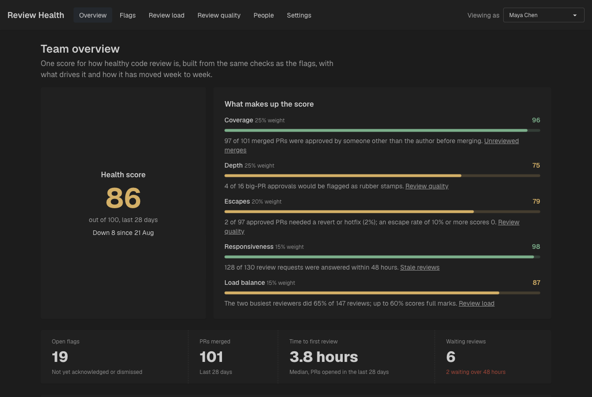
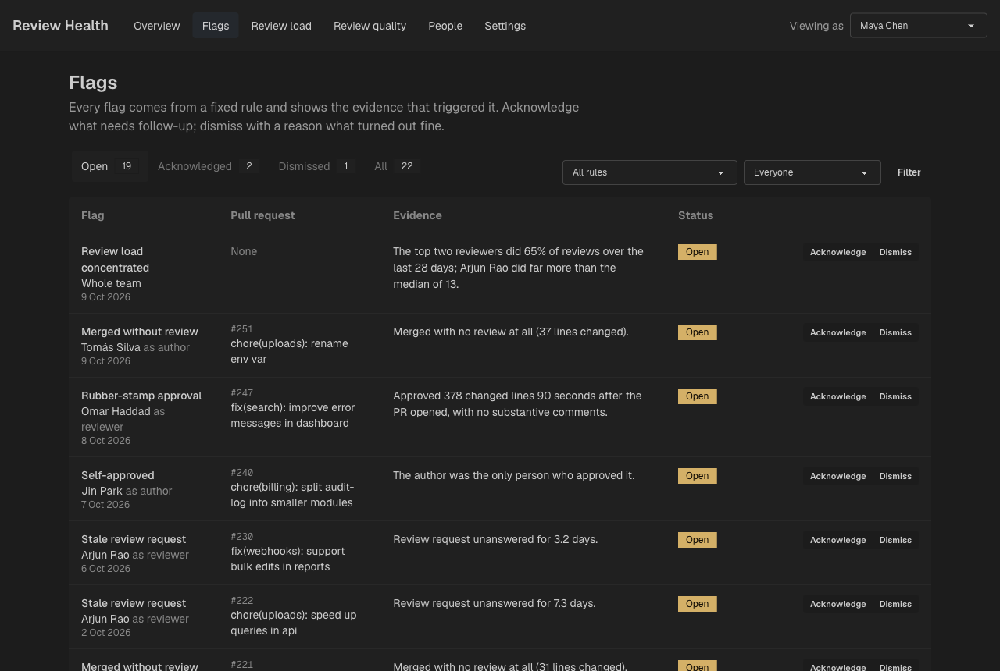
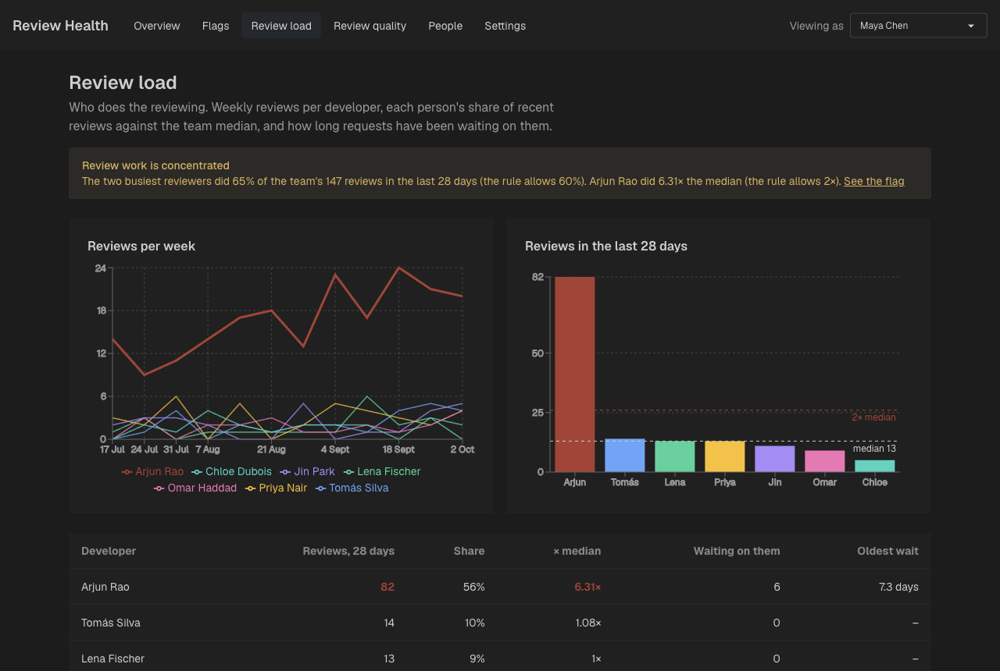
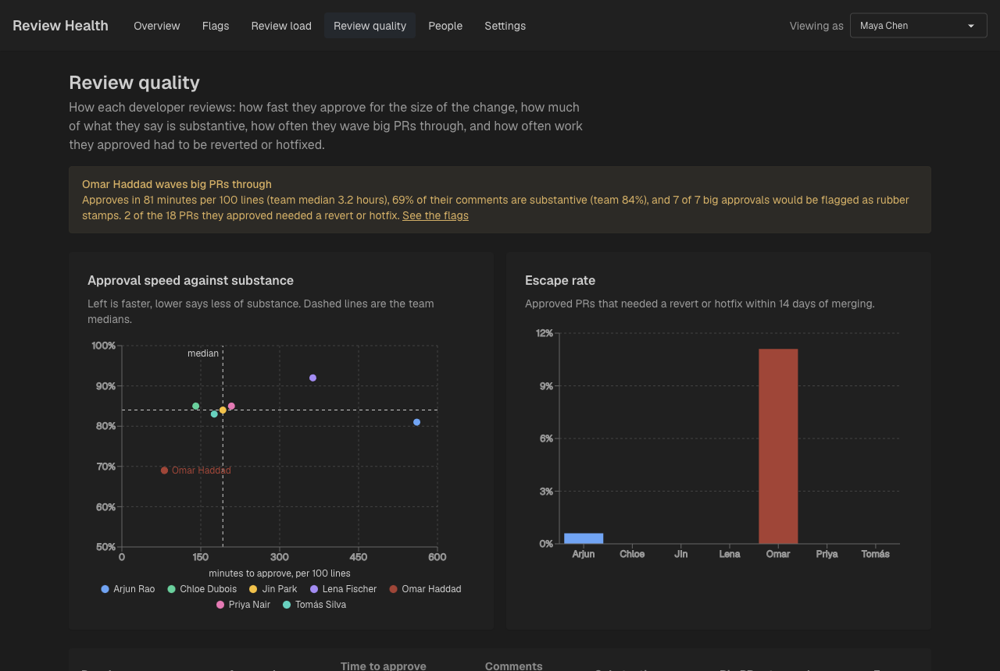
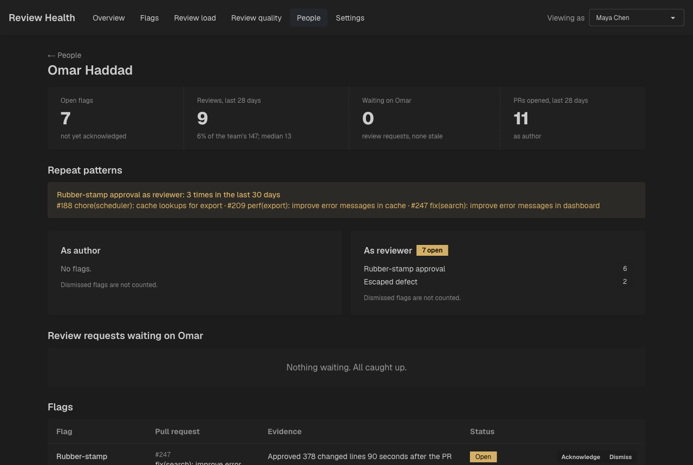
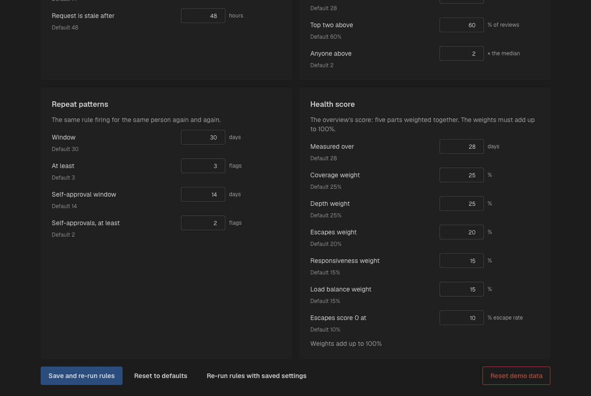

# Review Health Dashboard

Shows whether code review is working on a team and whether review work is shared fairly. Every flag is produced by a deterministic rule and shows its evidence.

## Run with Docker

Prerequisite: Docker Desktop running. Run every command from this folder (`review-burden/`).

```bash
docker compose up --build -d        # build both images and start them in the background (api seeds itself)
docker compose ps                   # both services should be "Up"; api should be "healthy"
docker compose logs -f              # follow logs (Ctrl+C stops following, not the app)
docker compose down                 # stop and remove the containers (data is kept)
```

Then open:

| URL | What |
|---|---|
| http://localhost:3000 | Web app |
| http://localhost:8000/api/health | API health check, returns `{"status":"ok"}` |
| http://localhost:8000/docs | Interactive API docs (Swagger) |

Other useful commands:

```bash
docker compose up --build -d web    # rebuild and restart only the frontend after changes
docker compose up --build -d api    # rebuild and restart only the backend after changes
docker compose logs -f api          # logs for one service
docker compose exec api sh          # shell inside the running api container
docker compose down -v              # stop AND delete the SQLite volume (wipes all data)
docker compose restart api          # reset the demo data (reseeds on start)
docker compose run --rm api python -m backend.seed   # reseed without restarting the api
```

The api container runs the seed every time it starts: it replaces every row with `backend/data/seed.json`, runs the rule engine, and applies the starting triage in `backend/data/triage.json`. Anything changed in the app (dismissed flags, edited thresholds) is lost on restart. The manager's "Reset demo data" button on the Settings page (`POST /api/demo/reset`) does the same without a restart. Both files are baked into the api image; rebuild the image after regenerating the data.

The images run production builds, so code changes need a rebuild (`--build`). For fast edit-and-refresh, run the services locally instead.

## Demo walkthrough (about 5 minutes)

The demo team has 8 people (Maya Chen is the manager) and 12 weeks of review history up to 9 Oct 2026, with problems planted on purpose (`backend/data/README.md` lists them). Open http://localhost:3000 as Maya.

1. **Overview.** The health score is 86, down 8 since 21 Aug. The weakest parts are Depth (4 of 16 big-PR approvals look like rubber stamps) and Escapes (2 approved PRs needed a hotfix). Each part links to the page that explains it.

   

2. **Flags.** 19 open flags, each with the evidence that raised it, such as "Approved 378 changed lines 90 seconds after the PR opened, with no substantive comments" (Omar Haddad on #247). Acknowledge one, or dismiss one with a reason. The Dismissed tab already has one: #151 was a live pairing session.

   

3. **Review load.** Arjun Rao did 82 of the team's 147 reviews in the last 28 days, 6.3× the median, and 6 review requests are waiting on him (two for over 48 hours).

   

4. **Review quality.** Omar approves fastest for the size of the change and says the least of substance: all 7 of his big-PR approvals were rubber stamps, and 2 of the PRs he approved needed a hotfix.

   

5. **People → Omar Haddad.** A repeat pattern: 3 rubber stamps in 30 days. The dismissed #151 is not counted.

   

6. **Viewing as a developer.** Switch "Viewing as" to Omar: he sees only his own page, and the team pages are closed to him.
7. **Settings** (back as Maya). Change "Big PR from" to 1000 lines and save: the rules re-run at once, 7 rubber-stamp flags disappear, and the dismissed one stays because a person decided on it.

   

8. **Reset demo data** (bottom right of Settings) puts everything back: the data, the starting triage and the default settings. Use it between run-throughs. `docker compose restart api` does the same.

## Run locally without Docker

Backend (Python 3.12 via [uv](https://docs.astral.sh/uv/)):

```bash
cd backend
uv sync
uv run python -m backend.seed       # creates review_health.db in backend/ with the demo data
uv run uvicorn backend.main:app --reload --port 8000
```

Frontend (Node 24):

```bash
cd frontend/review-burden
npm install
npm run dev                         # http://localhost:3000, talks to the API on localhost:8000
```

## Configuration

| Variable | Service | Default | Purpose |
|---|---|---|---|
| `DATABASE_URL` | api | `sqlite:////data/review_health.db` in Docker | SQLite file, stored on the `db-data` volume |
| `CORS_ORIGINS` | api | `http://localhost:3000` | Comma-separated origins allowed to call the API from a browser |
| `AS_OF` | api | `2026-10-09T18:00:00Z` (the synthetic data's `as_of`) | What the rules treat as "now". An ISO 8601 timestamp, or `wall` for the real clock |
| `API_URL` | web | `http://api:8000` in Docker, else `http://localhost:8000` | Where server-side Next.js code calls the API |
| `NEXT_PUBLIC_API_URL` | web (build arg) | `http://localhost:8000` | API address baked into browser code at build time; changing it needs a rebuild |

## Viewing as someone (no real auth)

The header's "Viewing as" switcher stores the chosen person's id in a `viewer_id` cookie. Server-side API calls forward it as the `X-Viewer-Id` header, and the API decides what that viewer may see. Picking a developer opens their own page (`/me`); picking the manager opens the team overview.

The switcher lists people from `GET /api/people`, which is open to everyone. Every other endpoint resolves the viewer from `X-Viewer-Id` (`backend/deps.py`):

- No header: the manager, matching the frontend's default before anyone is picked.
- Unknown id: 401. Non-numeric id: 422.
- The manager sees the whole team; a developer sees only data about themselves. Manager-only actions (such as triaging flags) return 403 for developers.

## Layout

```
review-burden/
├── docker-compose.yml          # api (:8000) + web (:3000), SQLite on the db-data volume
├── docs/screenshots/           # images for the demo walkthrough above
├── backend/                    # FastAPI, uv project, package `backend` under src/
│   ├── src/backend/main.py     # app, CORS, router registration
│   ├── src/backend/routes/     # one module per API area; deps.py (session, viewer), schemas.py (API models)
│   ├── src/backend/rules/      # rule engine: pure rules, params, patterns, engine runner
│   ├── src/backend/params_store.py  # rule params saved from the settings page (overrides on top of the defaults)
│   ├── data/                   # deterministic synthetic data (see data/README.md)
│   └── scripts/                # data generator, OpenAPI export for the frontend
└── frontend/review-burden/     # Next.js 16 (App Router), Tailwind + DaisyUI
    ├── app/                    # pages: overview, flags, load, quality, people, settings, me
    ├── components/             # header, nav, role switcher
    └── lib/                    # server-only API client, viewer cookie helpers, generated API types
```
